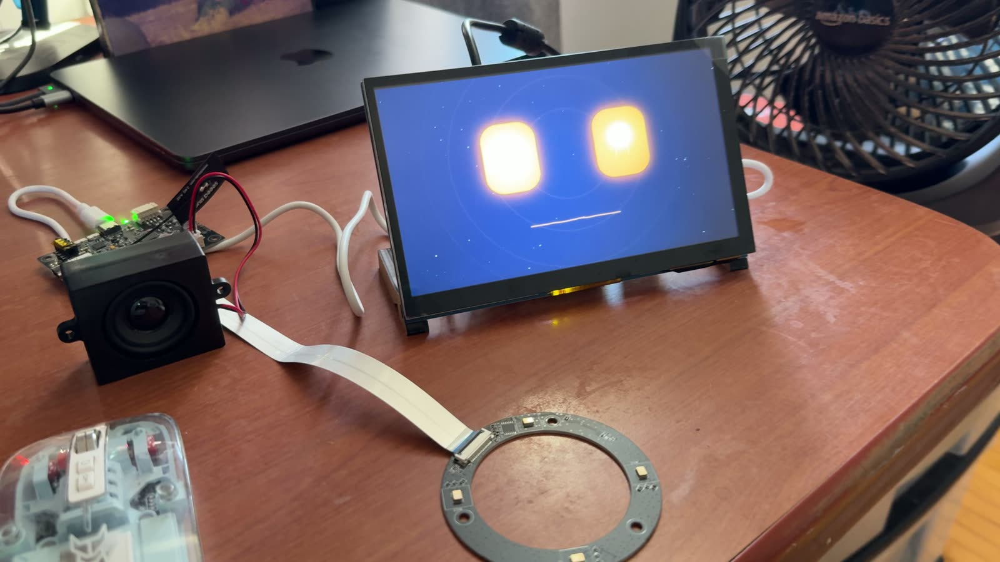
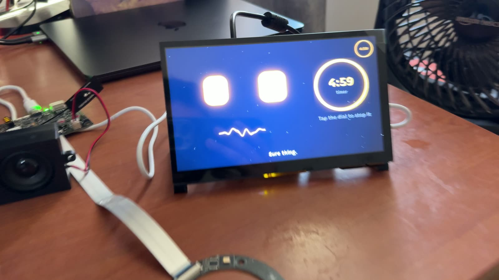
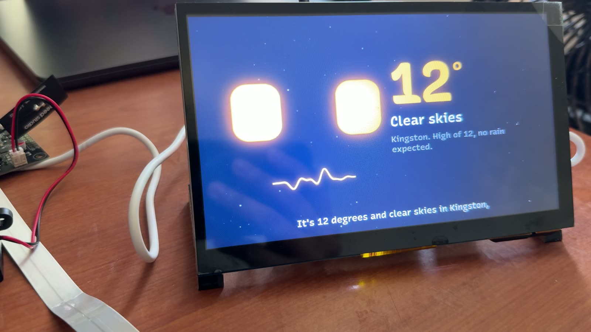
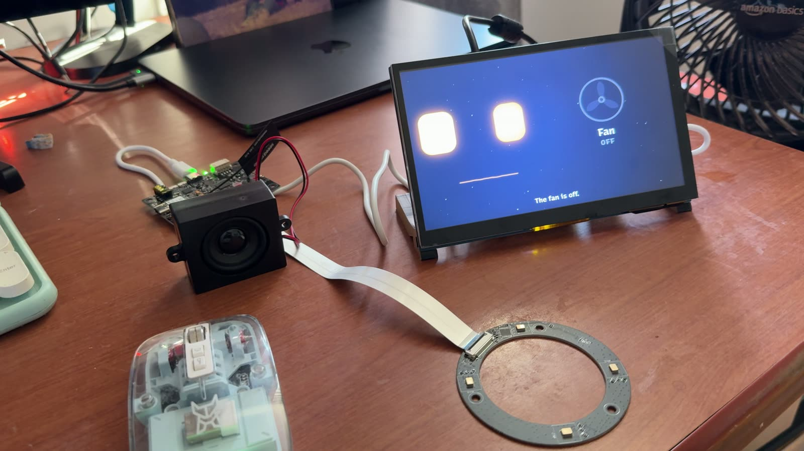
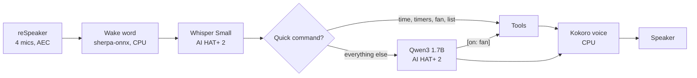

# Jansky v2: an always-on voice AI agent that runs on a Raspberry Pi

Say "Hey Jansky" and talk. It answers, switches your lights and fan, keeps your list, sets timers and remembers
you. The model, the speech recognition and the voice all run on the Pi. No subscription, no account, and your
voice never leaves the room.



| | | |
|---|---|---|
|  |  |  |

## What it does

- **Wake word** "Hey Jansky", heard across the room by a 4-mic array with echo cancellation. Talk over it to interrupt.
- **Brain:** Qwen3 1.7B on the AI HAT+ 2. Vague requests ("it's hot in here") turn into actions (fan on).
- **Home:** lights, fans and switches through Home Assistant.
- **List and reminders:** "remind me to buy a pen tomorrow" goes on screen until you tick it off.
- **Timers, weather, news, quick facts.**
- **Memory:** "remember that my favourite colour is green". Kept in a plain text file you can edit.
- **A face** on the touchscreen that looks toward whoever is talking.

## Hardware

| Part | Notes |
|---|---|
| [Raspberry Pi 5, 8 GB](https://www.raspberrypi.com/products/raspberry-pi-5/) | 4 GB is too small for the voice model plus the face |
| [Raspberry Pi AI HAT+ 2](https://www.raspberrypi.com/products/ai-hat-plus-2/) | Hailo-10H. Runs the LLM and Whisper |
| [Active Cooler](https://www.raspberrypi.com/products/active-cooler/) | Required. Without it the Pi throttles at 85 °C |
| [reSpeaker Flex XVF3800 Circular-4 with XIAO ESP32S3](https://www.seeedstudio.com/reSpeaker-Flex-XVF3800-Circular-4-with-XIAO-ESP32S3-p-6739.html) | Mic array. Plug into a **USB-A** port |
| Small speaker, 4 Ω, 3–10 W | On the reSpeaker's JST output, so its echo cancellation can hear it |
| 7" 800×480 DSI touchscreen | The face. The [official 7" display](https://www.raspberrypi.com/products/raspberry-pi-touch-display/) or the [Freenove 7"](https://www.amazon.ca/dp/B0B44VZTRG) |
| [27 W USB-C power supply](https://www.raspberrypi.com/products/27w-power-supply/) | |
| microSD card, 32 GB or more | Raspberry Pi OS 64-bit (Trixie), desktop |

## Install

On a fresh Raspberry Pi OS (64-bit, desktop), with everything plugged in:

```bash
curl -fsSL https://raw.githubusercontent.com/mayukh4/jansky/main/install.sh | bash
```

It sets up the AI HAT+ 2 driver, flashes the reSpeaker's USB firmware (it tells you when to hold the button),
downloads the models (~4 GB), installs the app and puts a **Jansky** icon on the desktop. Then reboot.
Running it again is safe: finished steps are skipped.

## Use

- Tap the **Jansky** icon. The face fills the screen.
- Say **"Hey Jansky"**, then your request.
- Hold the screen for one second to mute it. Swipe down → **Close Jansky** to quit.

Settings go in `~/jansky-v2/.env`:

```bash
JANSKY_USER=Alex                 # what it calls you
HOME_CITY=Kingston               # for the weather
HOME_LAT=44.23
HOME_LON=-76.49
HA_URL=http://homeassistant.local:8123
HA_TOKEN=your-long-lived-token   # Home Assistant → Profile → Security → Long-lived access tokens
```

## How it works



Common requests skip the model and answer in under a second. Everything else goes to Qwen3, which can reply with a
short command (`[on: fan]`, `[remind: … | …]`) that the program runs.

**What goes online:** weather (Open-Meteo), news and fact lookups (Google News, Wikipedia), and your Home Assistant
on your own network. Your voice and your conversations stay on the Pi.

## Limits

- The brain is small: it picked the right tool 17 times out of 24 in testing.
- Its context is 2,048 tokens, so long chats lose their start.
- Home control is on/off only. No scenes or brightness yet.
- It can't read your email or book things.

## Credits

Named after [Karl Jansky](https://en.wikipedia.org/wiki/Karl_Guthe_Jansky), who started radio astronomy.
Built on [HailoRT](https://github.com/hailo-ai/hailort), [Qwen3](https://github.com/QwenLM/Qwen3),
[sherpa-onnx](https://github.com/k2-fsa/sherpa-onnx), [Kokoro](https://github.com/thewh1teagle/kokoro-onnx) and
[openWakeWord](https://github.com/dscripka/openWakeWord) (Silero VAD). Version 1:
[pibot_local_agent](https://github.com/mayukh4/pibot_local_agent).

Video: *coming soon*. MIT License.
